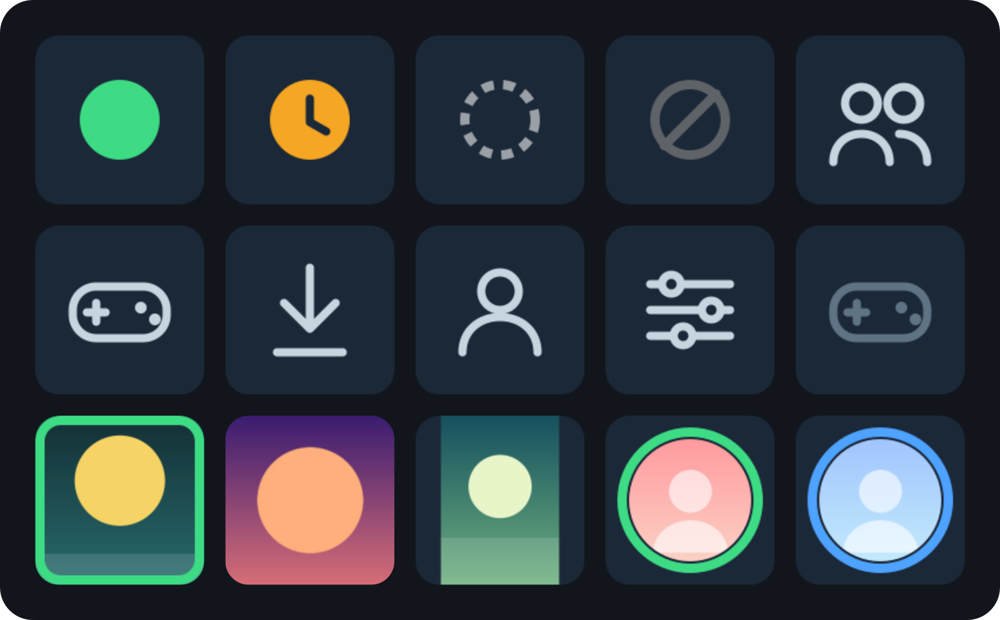
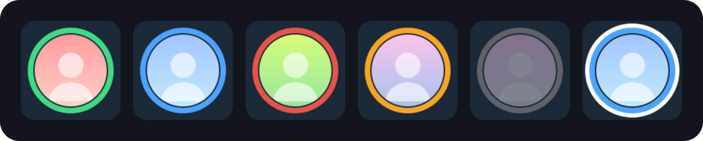

# Steam Dashboard Controller

An [OpenDeck](https://github.com/ninjadev64/OpenDeck) plugin that turns Stream Deck keys into a Steam
dashboard on Linux. It goes beyond changing your chat status: you can launch games, watch friends come
online and open or close Steam's windows from a key.



- **Top row:** Steam Status (online, away, invisible, offline) and Open Steam View (friends).
- **Middle row:** the other views and the launch key with no game chosen.
- **Bottom row:** launch keys (running, header art, 70% image size) and friend keys.

The games and friends shown are made up.

## Keys

| Key | What it does |
|---|---|
| **Steam Status** | Sets your chat status: Online, Away, Invisible or Offline. |
| **Open Steam View** | Opens Library, Friends, Downloads, Account or Settings. Pressing it again closes that window. |
| **Launch Steam Game** | Shows an installed game's art and launches it. Choose cover, header or logo art, and an image size of 20–100% to leave a border. A green ring shows while the game is running. |
| **Steam Friend** | Shows a friend's avatar with a ring in their status colour (in game, online, busy, away, offline). Pressing it opens a chat. The key can flash for about six seconds when the friend comes online. |

### Friend key states



The ring colour is the friend's state: green in game, blue online, red busy, amber away, grey and dimmed
offline. The last key is the white flash frame shown for about six seconds when a friend comes online.

## Requirements

- Linux with [OpenDeck](https://github.com/ninjadev64/OpenDeck) and the Steam client (native install under `~/.local/share/Steam` or `~/.steam/steam`)
- Node.js 20 or newer (OpenDeck runs the plugin with it) and `xdg-open`
- `wmctrl` for the open/close toggle on the view keys (optional; without it the keys just open the view)
- A [Steam Web API key](https://steamcommunity.com/dev/apikey) for the Steam Friend key only

## Install

Download `opendeck-steam-<version>.zip` from the [latest release](https://github.com/TonyHeadband/opendeck-steam-plugin/releases/latest),
unzip it into `~/.config/opendeck/plugins/` so that `io.github.tonyheadband.opendeck-steam.sdPlugin` sits there, and
restart OpenDeck. The keys appear in the **Steam** category.

To build from source instead:

```bash
git clone https://github.com/TonyHeadband/opendeck-steam-plugin
cd opendeck-steam-plugin
pnpm install
scripts/install
```

`scripts/install` copies the built plugin into `~/.config/opendeck/plugins/` (a symlink does not work, OpenDeck
refuses to serve its settings panels through one). `scripts/package` builds the release zip in `dist/`.

## Setting up the keys

Drag a key from the **Steam** category onto your deck, then click it to open its settings panel.

- **Steam Status:** pick **Status** (Online, Away, Invisible or Offline). Pressing the key sets that chat status.
- **Open Steam View:** pick **View** (Library, Account, Downloads, Friends or Settings). Pressing the key opens that
  view in Steam; pressing it again closes the window.
- **Launch Steam Game:**
  - **Game:** every game Steam has installed, most recently played first. A game you uninstalled later stays
    selectable and still launches (Steam offers to install it).
  - **Art:** Auto (cover, else header, else logo), Cover, Header or Logo. Only the art Steam has cached for that
    game is offered.
  - **Image size:** 20–100%. 100 fills the key; lower values shrink the art and leave a border (70 shrinks it by 30%).
    The green running ring always stays full size.
- **Steam Friend:**
  1. Paste your Steam Web API key into **Steam Web API key** and press **Save key**. **Clear key** removes it.
  2. Pick a friend in **Friend**: you first, then friends who are online or in game, then the rest alphabetically.
  3. Tick or untick **Flash when this friend comes online** (on by default).

Presence is read every minute from the Steam Web API, so the Friend key is only as fresh as that. Friends with
non-public profiles can read as offline even when they are online; that is a Steam API limit.

The API key is stored in plain text in OpenDeck's plugin settings under `~/.config/opendeck`. It is sent
only to `api.steampowered.com`; avatars are fetched only from Steam's image hosts. The plugin never logs the
key. Keep OpenDeck's log level at its default: at TRACE the SDK logs raw messages that contain it.

## How it works

- Installed games and their art are read from Steam's local library files.
- Running games are found by scanning `/proc` for Steam's launch wrapper (`SteamLaunch AppId=…`).
- Open and close uses `wmctrl` to find Steam's own windows and close only the matching one.
- Keys are drawn as SVG data URIs.

## Development

```bash
pnpm install
pnpm lint && pnpm typecheck && pnpm test
pnpm build
```

`docs/smoke-test.md` is the manual checklist to run in OpenDeck after `scripts/install`.

`node scripts/render-previews.mjs` regenerates the images in `docs/images` from the plugin's own icon code with
synthetic data (needs ImageMagick and Inkscape).

## License

[MIT](LICENSE)
